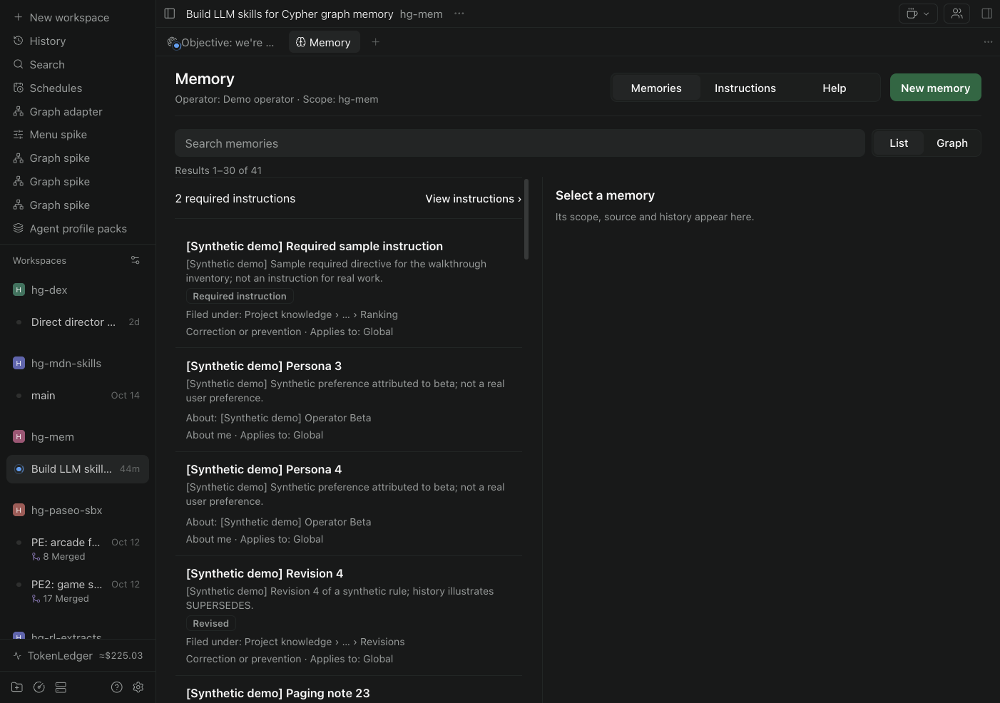
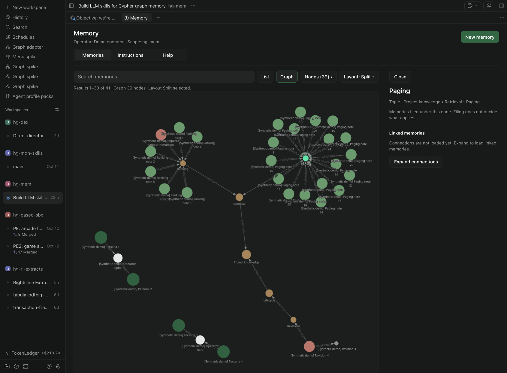
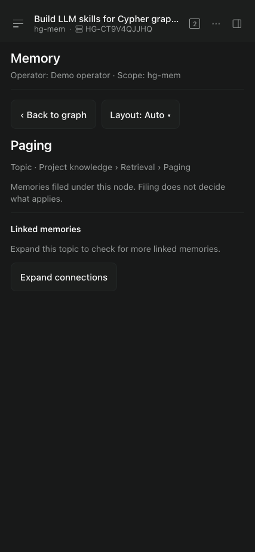

# hg-mem

Local, persistent memory for agents and people in Paseo. Save preferences, project
knowledge, and instructions. Search them, inspect their sources, and explore their
connections in a graph.

Agents are the primary writers: useful durable observations can be saved without
per-memory approval. People review attribution, sources, scope, and content, and
can remove unwanted memories from recall. Removal retains the evidence in history.

The database stays on the daemon host. The UI and agent skills use the same SQLite
CLI and GraphQLite recipes. No Python runtime or separate MCP server is required.

Agent skills: start with `memory-workflow`; it routes to `memory-recall`,
`memory-write`, `memory-setup`, and `memory-maintain`. All five ship together as text.

## Install and run

This iteration targets **Paseo 0.12.x**, macOS Apple Silicon, and Homebrew SQLite
3.53 or newer. GraphQLite is pinned to the official 0.12.0 macOS arm64 library.

```sh
brew install sqlite
cd paseo-hg-mem
npm ci
# Use the absolute plugin path on the daemon host.
paseo --host 127.0.0.1:6767 plugin install "$PWD"
paseo --host 127.0.0.1:6767 plugin ls
```

Open **Settings → Plugins → Memory setup**. Set the operator name and ID, database
path, SQLite CLI path, and GraphQLite extension path. Save setup, then explicitly
create/connect the store. Initialization refuses unmanaged databases.
Choose **Install or update memory skills** to publish the five `memory-*` skills
for agents on this host. Recognized old skills are archived; modified copies are
preserved and reported. Open a new agent session afterward. No daemon restart.

Download the extension from the [official release](https://github.com/colliery-io/graphqlite/releases/tag/v0.12.0).
The required asset is `graphqlite-macos-arm64.dylib`; SHA-256:
`46ff8b643847840a48806bfa1ed1bb27762cdbd08a72d7d3b04b4bbae0b2e886`.
The plugin does not bundle SQLite or this extension.

Open the **Memory** workspace tab, or use `/memory architecture`. **Memories**
offers List and Graph; **Instructions** lists applicable required items independently
of search; **Help** explains the concepts. Select a node to inspect it. Expand
connections explicitly. Layout → Split keeps the inspector beside the graph.





Screenshots use synthetic walkthrough records. Some show earlier wording.

## Memory model

A memory has a title, body, purpose, source locator, attribution, scope, status,
and effective interval. **Required instruction** is a separate flag, not a purpose.
It records an explicit imperative; a preference does not silently become a rule.

```text
Memory:Persona | CAPA | Operational
  ├─ APPLIES_TO → Scope (global, directory, project, session)
  ├─ FILED_UNDER → Domain, Area, or Topic
  └─ ABOUT → Operator (subject, not author)
Topic ─ CHILD_OF → Area ─ CHILD_OF → Domain
new Memory ─ SUPERSEDES → old Memory
```

Operational memories require filing; Persona memories require an Operator subject.
Directory scope covers that directory and descendants, not sibling worktrees.
Global means this store on this host. Filing explains organization, not applicability.

Examples: “I prefer concise answers” is a preference. “Do not run migrations without
my approval” may be a required correction with a source. A project note can summarize
a document and retain its source locator; the locator is not verified evidence.

Current recall filters status, time, and scope before paging. Replacement history
is explicit. Retraction never revives a predecessor. Agents receive skills and a
prompt pointer; this is a workflow instruction, not a pre-tool enforcement gate.

## Develop

```sh
cd paseo-hg-mem
npm ci
npm run generate          # After changing canonical skill Markdown
npm run typecheck
npm run test:graph
# Integration tests use disposable stores, never the configured user database.
HG_SQLITE=/opt/homebrew/opt/sqlite/bin/sqlite3 \
HG_EXT=/absolute/path/graphqlite.dylib npm test
paseo --host 127.0.0.1:6767 plugin reload hg-mem
paseo --host 127.0.0.1:6767 plugin logs hg-mem
npm pack --dry-run        # Inspect the plugin shipping boundary
```

There is no standalone web dev server. Run the plugin in Paseo and reload it after
changes. Do not restart the daemon for ordinary plugin work.

Agent CLI example, after loading the session functions from
[runtime.md](skill/memory-workflow/references/runtime.md) and receiving `HG_*` settings:

```sh
export HG_INPUT=$(mktemp)
# Scope and paths are supplied by the current host/workspace.
cat > "$HG_INPUT" <<'JSON'
{"cwd":"/absolute/workspace","scopes":[],"query":"arch","limit":20,"offset":0}
JSON
{ hgblock memory-workflow/references/eligible.md; hgblock memory-recall/references/search.md; } | hgsql
rm -f "$HG_INPUT"
```

Always run the independent directive inventory before acting; lexical search is
not that inventory. See [recall](skill/memory-recall/SKILL.md) for directives,
search, exact reads, bounded exploration, and parameterized Cypher examples.

## Source map and limits

| Path | Purpose |
| --- | --- |
| `paseo-hg-mem/` | Installable plugin: UI, server, contracts, embedded assets |
| `skill/` | Canonical text-only skills and SQL recipes, including Paseo entry point |
| `tools/`, `tests/` | Build helpers and pure graph tests; not plugin runtime |
| `docs/` | Design, lessons, research summaries, and selected screenshots |
| `discovery/`, `research/`, `.local/` | Ignored local experiments, fixtures, downloads, and upstream checkouts |

The graph is web/desktop only, bounded to 120 loaded nodes. Native clients use
list/path browsing. Renderer errors have a local fallback; browser/GPU crashes
and arbitrary async failures are outside that boundary. Fonts may use external
services. UI content editing is not implemented. Full validation and FTS rebuilding
on writes currently suit small stores.

See [working guide](AGENTS.md), [lessons](docs/lessons.md), and
[documentation index](docs/README.md).
