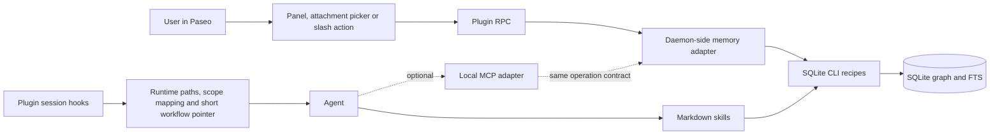

# Paseo plugin integration research

Research date: 2026-10-23. Read deployed documentation after fetching `llms.txt`;
cross-checked published `@getpaseo/plugin` and `@getpaseo/protocol` 0.12.0 types.
The connected desktop app and daemon at `127.0.0.1:6767` both report 0.12.0.
No plugin was created, installed or enabled; no daemon configuration was changed.

## Recommendation

Use a Paseo plugin for integration, retain the Markdown skills for agent workflow,
and reuse the existing SQLite CLI transaction recipes as the storage implementation.
Native plugin RPC serves application UI. MCP is an optional additional agent
interface, not a prerequisite for a plugin or a replacement for the memory model.

Start with setup/context integration. Add a workspace memory panel and explicit
memory attachments if application UI is needed. Add read-only MCP tools only if
skill invocation, shell availability or structured responses justify the extra
interface. Do not start with a separate always-running HTTP memory service.



This is a proposed topology. If stdio MCP runs in a separate process, it imports
the same operation implementation rather than calling a private plugin RPC.

## Interfaces are complementary

| Surface | Who invokes it | Role for hg-mem | Limit |
| --- | --- | --- | --- |
| Markdown skill | Agent/provider | When to recall, source checking, classification, writing and navigation workflow | Requires provider discovery or an explicit skill pointer; shell access for current recipes |
| Plugin slash command | User in composer | Open/search memory, invoke an explicit agent workflow | Runs client callback; submitted command text is not automatically sent to the model |
| Plugin RPC | Plugin client surface | Typed calls to daemon-local memory operations | Not automatically an MCP tool or an agent-callable CLI command |
| MCP tool | Agent through provider | Structured search, read and directive inventory | Additional server/runtime/transport and parity tests; support varies by provider |
| Lifecycle hook | Paseo daemon | Set launch context; observe lifecycle | No documented synchronous before-every-tool or before-every-prompt hook |
| Attachment source | User selecting prompt context | Search memories and attach a bounded, provenance-bearing text snapshot | Snapshot is not automatically refreshed after submission |

Do not name a plugin slash command `/hg-mem` without considering collisions:
plugin commands take precedence over provider commands/skills. Prefer one distinct
command such as `/memory` opening the panel. A callback can explicitly call
`agent.send` to request a skill workflow, but that is an intentional message and
may start or steer a turn; it is not automatic slash-command behavior.

## Relevant plugin capabilities

| API | Application |
| --- | --- |
| `server.before('agent.create')` | Append a short memory-workflow pointer to existing `systemPrompt`; optionally merge an MCP configuration |
| `server.before('agent.session_open')` | Supply environment paths/context on create, resume, refresh and import; editable field is env only |
| `server.handle` + `defineRpc` | Validate UI request/response shapes and call the memory adapter |
| `registerSettings` + `defineSettings` | Persist host-level DB/runtime paths, selected Operator and explicit project-scope mappings |
| `addWorkspacePanel` | Workspace-context search, record details, filing navigation, directives and conflicts |
| `addCommandCenterItem`, `addSlashCommand` | Explicit entry points to the same panel/actions |
| `addAttachmentSource` | Attach selected memory summaries/directives to an agent prompt with IDs and provenance |
| `addComposerPill` | Optional visible memory/directive status; its presence alone does not prove agent compliance |
| Timeline append/renderer | Optional visible receipt for a recall/save; a rendered row is not automatically model context |

Server code runs in a daemon subprocess and can access Node filesystem/process
APIs. UI code runs in Paseo clients, including phones; keep SQLite, local files and
process execution on the server. A panel must use React Native primitives, theme
colors and compact layout. Normal Paseo actions use the existing SDK; database
operations use plugin-specific RPC.

The published 0.12.0 SDK confirms the APIs above. Current docs also contain newer
or unreleased features; do not assume the whole current reference works on 0.12.0.
Pin the SDK and set plugin requirements for the versions actually tested on both
app and daemon. No new provider implementation is needed.

## Agent setup and directive recall

```text
# New agent: preserve existing instructions; append a short root-skill pointer.
# Session open: supply HG_DB, HG_EXT, HG_SQLITE and a stable HG_SKILLS location.
# Resolve actual cwd, workspace/project binding and selected Operator on the host.
# Agent uses the root workflow to load all applicable required directives.
# Query again after relevant scope changes; do not embed an enduring content snapshot.
```

`agent.create` hooks do not cover importing or reopening an existing agent.
`agent.session_open` does cover those cases but can change only environment,
not retrofit its saved system prompt or MCP configuration. Existing-agent adoption
therefore needs an explicit provider/session procedure tested separately.

Turn-start and turn-end events are live, best effort and not replayed. Their
handlers can overlap; failure does not roll back the triggering action. Before
hooks can block their documented creation/opening operation, but they are not
per-tool interceptors. Permission events cover only actions that request
permission. Neither hooks nor MCP presence guarantee that every coding action
was preceded by a CAPA check.

Avoid an `agent.send` loop for context injection. Avoid automatically storing every
turn, generating memories from transcripts, answering permission requests from
stored rules, or inferring that a UI receipt means a directive was read. Those
are separate product behaviors, not consequences of installing memory support.

## Reuse the CLI implementation

The plugin adapter should initially spawn the same extension-enabled SQLite CLI
and execute the same validated SQL blocks in one connection per operation.
Use argument arrays and stdin, not a shell command containing user text.

```text
# Request: validate operation, context and JSON values.
# Bind JSON; run the bundled SQL recipe in one sqlite3 process.
# BEGIN IMMEDIATE -> invariants -> graph changes -> FTS -> invariants -> COMMIT.
# Buffer process output; report committed success only after successful exit.
# Cancel/timeout -> terminate owned process and surface outcome uncertainty.
# Never retry an uncertain mutation automatically; inspect its stable public ID.
```

The SDK exports `spawnProcess`, `execCommand` and `terminateProcess`. The existing
Markdown loader is shell-based; plugin code should load its trusted bundled SQL
directly and normalize output into typed responses. A disposable bridge probe
round-tripped JSON via a hex SQL literal into a bound CLI parameter, including
quotes, newlines and Unicode. That checks encoding, not plugin runtime integration.

Retain the CLI `-bail` and stdin transaction behavior. SQL in `-cmd` caused silent
stdin skipping in our tested shell path, so use `-cmd` only for dot commands.
Do not adopt a second Node SQLite implementation merely to add UI: it would need
its own extension/version, validation and index-maintenance equivalence evidence.
This is a reuse recommendation, not a claim Node SQLite is inherently unsuitable.

## If MCP is added

Published protocol 0.12.0 defines stdio (`command`, `args`, `env`), HTTP and SSE
server configurations. Providers advertise MCP support. Types are not proof that
each installed provider executes our server correctly; Claude-specific flags such
as `alwaysLoad` are not portable behavior.

Prefer a local stdio prototype over a new HTTP listener. No port or network service
is needed for stdio, but a runnable packaged entry and its process lifetime still
need verification. A Paseo plugin server entry is not itself an MCP server.

| MCP surface | Initial scope |
| --- | --- |
| `memory.search` | Scope/time eligibility before candidate limits; public IDs and match reasons |
| `memory.read` | Exact record and provenance; explicit historical status |
| `memory.navigate` | Bounded typed graph traversal with path explanation |
| `memory.directives` | Complete inventory with visible paging/uncertainty, independent of lexical terms |

Keep writes in the existing controlled recipe path initially. If later exposed as
tools, use the same narrow operation contract rather than arbitrary SQL/Cypher.
UI RPC and MCP must agree with CLI results and errors. An MCP call should not take
an arbitrary database/extension path from the model; resolve those from configured
host context. Authority asserted by the model still requires the skill's evidence
contract; JSON schema cannot establish human intent.

Before choosing stdio in production, test whether agent-owned MCP processes stop
on session closure and what happens when the plugin is disabled, updated or
removed. Creation-time MCP configuration is saved agent configuration; plugin
teardown does not by itself prove those agents lose their tools. HTTP would instead
require endpoint lifetime, port selection, access controls and reload/reconnect
handling. Neither transport should become a second storage implementation.

## Identity, storage and packaging

- Install the plugin per daemon. The selected host owns runtime files and database
  access, even when the user operates Paseo from a phone. No cross-host database
  synchronization or fallback is implied.
- Keep the database outside plugin source/build/cache directories so updates or
  removal cannot discard memories. Settings are host-scoped JSON, shared by that
  host's authorized clients; they are not a per-user identity or credential store.
- Operator identity is not established by lifecycle payloads. Confirm a configured
  Operator rather than treating agent/provider identity as the human operator.
- Explicitly map host/project/workspace IDs to memory Scope IDs. Worktrees change
  cwd; repository-directory scope does not automatically cover another checkout.
  Use a project binding without silently broadening existing directory scopes.
- Bundle the Markdown skills as package assets, but do not assume automatic skill
  installation. The SDK has no documented generic skill-registration API. Verify
  provider discovery and a stable installed asset path, or point at an explicitly
  installed skill bundle. Do not overwrite workspace instruction files implicitly.
- Skills remain text-only. The Paseo plugin is a separate TypeScript application
  artifact; it uses the daemon's plugin runtime and does not require Python.

## Suggested sequence and exit gates

1. **Small setup plugin.** Host settings; read-only dependency/schema health;
   environment hook; short new-agent workflow pointer. Verify actual skill
   discovery or direct reading on Codex and Claude, including resume/import.
2. **Application surfaces.** Workspace panel, one distinct slash entry and memory
   attachment source using read-only RPC. Prove correct host/workspace context,
   directive paging and source-state presentation on desktop and compact client.
3. **Optional MCP spike.** Only after a concrete agent-interface gap. Verify stdio
   startup/tool visibility, provider capabilities, reload/disable/session lifetime,
   packaged executable paths, clean protocol stdout and parity with CLI outputs.
4. **Explicit write integration.** If desired, user-invoked writes or agent skill
   workflows call the same atomic recipes. Check literal data, rejected operations,
   cancellation, concurrent clients and ambiguous commit responses.

For all phases, test worktree mapping, existing sessions, missing dependencies,
offline hosts and plugin reload. Hook events are not a durable extraction queue;
do not claim exactly-once memory capture or guaranteed pre-action enforcement.
The next deliverable is a small integration spike, not a new memory engine.

## References

- [Paseo plugin quickstart and runtime boundaries](https://paseo.sh/docs/plugins.md)
- [Lifecycle and configuration hooks](https://paseo.sh/docs/plugins/reference.md#lifecycle-hooks)
- [Editable creation and session-open fields](https://paseo.sh/docs/plugins/reference.md#before-hooks)
- [Client slash commands and precedence](https://paseo.sh/docs/plugins/reference.md#slash-commands)
- [Plugin-specific backend RPC](https://paseo.sh/docs/plugins/reference.md#add-plugin-specific-backend-behavior)
- [Memory attachment-source integration](https://paseo.sh/docs/plugins/reference.md#add-a-composer-attachment-source)
- [Host-scoped plugin settings](https://paseo.sh/docs/plugins/reference.md#persisted-values)
- [Publishing and inclusion of package assets](https://paseo.sh/docs/plugins/publishing.md)
- [Provider commands, skills and session-scoped MCP configuration](https://paseo.sh/docs/sdk/reference.md)
- [Published plugin SDK 0.12.0 metadata](https://registry.npmjs.org/@getpaseo/plugin/0.12.0)
- [Published protocol 0.12.0 metadata](https://registry.npmjs.org/@getpaseo/protocol/0.12.0)
- [Captured exact-version type evidence](../../research/paseo-plugins/evidence-0.12.0)
- [Existing text-only skill release](skill-release-v1.md)
