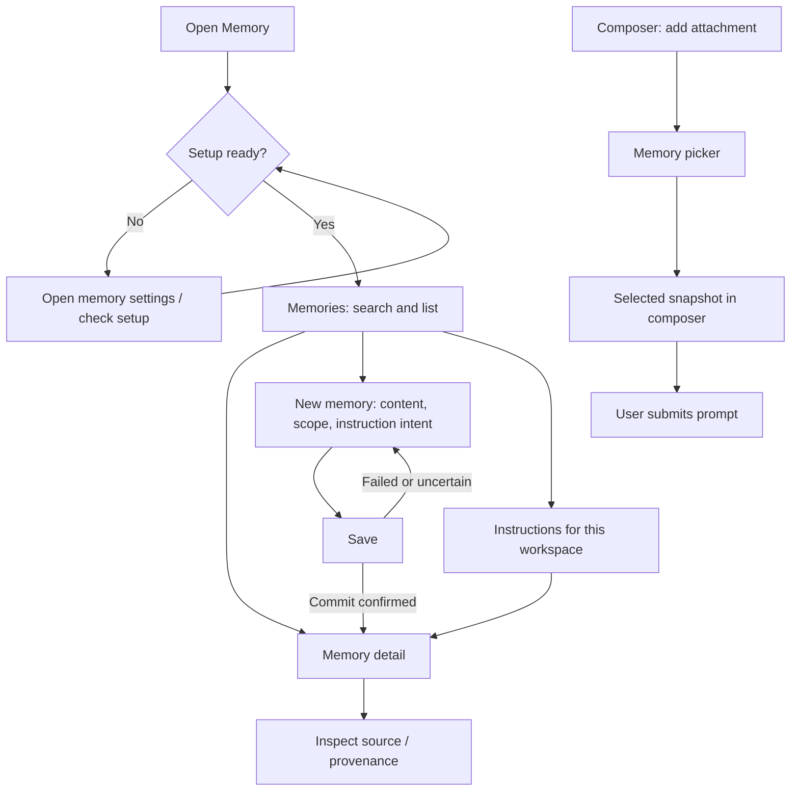

# hg-mem native Paseo UX review

Reviewed 2026-10-23 by the Visual Product Designer. This is a design recommendation,
not an implementation or a claim of live UI verification.

## Three priorities

1. Make the workspace Memory panel a familiar search/list/detail experience. Keep
   the current workspace context visible, and give applicable required instructions
   their own inventory independent of search terms.
2. Ask for human meaning before storage mechanics: what to remember, where it
   applies, and whether it is an instruction. Put runtime paths in Settings and
   portable IDs/graph relations in expanded details.
3. Make outcomes precise. A committed save, a prompt attachment, a source check,
   and an agent reading instructions are separate events. Show the event that
   actually happened and preserve uncertainty.

## Inspected evidence and limits

- Read the integration proposal, cached Plugin UI/Settings/Workspace panels
  reference, shipped schema and write/recall contracts.
- Inspected the initial `paseo-hg-mem` greeting scaffold. It is not a memory UI;
  there were no implemented memory flows to evaluate in that snapshot.
- Inspected the installed `@getpaseo/plugin` 0.12.0 declarations. The native
  Settings components are in `client/ui`. Modal, Icon, toast, clipboard, and
  sheet-aware input/list declarations are in the older `client/react-native`
  entry. The current reference puts these in `client/ui`. Verify the host runtime
  import before using these controls; declaration presence alone is not a live
  runtime test. Neither inspected entry declares Markdown.
- Current-doc `addAgentPanel`, unified panel params, `useTabState`, and panel
  `tab.setModified` are 0.13 additions, absent from the inspected 0.12 contract.
  The 0.12 workspace panel uses `context: "workspace"`.
- Paseo browser tools are absent from this agent's exposed tool catalog. The lead
  supplied a development helper that invokes Paseo's existing browser MCP tools.
  A read-only snapshot of the shared tab at `http://127.0.0.1:6767/` succeeded and
  returned an empty document (0 nodes/refs), before plugin installation. No memory
  interface was observed in that snapshot. A later setup screenshot was inspected
  as recorded below. The lead owns navigation, clicks and resizing. No
  substitute browser, database writes, installs, or implementation edits were
  performed.

## Entry points and wireflow

Use one **Memory** workspace panel. Command Center and one distinct slash command
open that panel. The composer attachment source remains the native place to add
memory context to a prompt. Setup belongs under the plugin's native Settings.



Opening Memory, viewing a record, saving one, and selecting an attachment must not
send a message to an agent. Keep any explicit agent action separately named.

### Setup and empty states

Before setup, show **Connect a memory store** with a short explanation of the host
that owns it. **Open memory settings** leads to native SettingsSection/Card rows.
Group the store/runtime paths under **Runtime**, operator identity under **Operator**,
and project bindings under **Workspace context**. Paths are paths on the selected
daemon host, including when the operator is using a phone.

**Check setup** is read-only. Distinguish configuration saved from store accessible
and schema supported. Resolve the store before offering existing operator/scope
choices. A required unavailable dependency gets a specific next step. Do not
silently initialize a new store, replace invalid settings, or switch databases.

After setup, a genuinely empty store can say **No memories yet** and offer **New
memory**. A search returning nothing says **No matches for “…”**, retains the query
and context, and offers **Clear search**. Do not use either empty state for a
failed request, missing mapping, loading state, or unavailable host.

### Search and list/detail

Use **Memories** and **Instructions** as the two primary modes. The panel header
shows the readable workspace and selected operator. A small context explanation
states that recall includes applicable global, mapped project/session, and current
directory memories. Show mapping gaps explicitly rather than calling the results
complete. Selecting an operator must not imply that instructions are filtered by
their author; actual eligibility follows the shipped scope/time contract.

For Memories, start with a search box and one **New memory** action. If the adapter
does not support a recent-memory list, use a search prompt on an empty query;
do not show an invented recent list or call an unsearched store empty. Query text
must never narrow the separate required-instruction inventory.

Each result is a full-width row: readable title, at most two lines of preview,
scope label, and a **Required instruction** label when true. Show **Inferred** or
an applicability warning when material. Avoid decorative per-record cards,
database counts, graphs, and an unexplained confidence score.

Wide panels can use a list beside a detail pane when both remain readable.
Narrow panels use one pane at a time even on desktop. Compact opens detail with
**Back to results**, preserving query, selected mode, and list position while the
panel remains mounted. Persistent restoration is a later capability unless a
supported 0.12 mechanism is verified.

Detail order:

1. Title and complete selectable content.
2. Required/ordinary memory, readable applicable scope, current applicability.
3. Who asserted it and whether explicit, observed, or inferred.
4. Source reference and its actual check/access state.
5. Expanded **Details**: public ID, exact scopes, validity times and typed relations.

Names are for comprehension; exact public IDs remain available in Details for
disambiguation. Full source references must remain selectable even when opening
the source is unavailable. Only offer **Open source** when the client/server can
resolve that source type. Do not fabricate a web URL from an opaque reference.

### New memory

Keep the draft within the native panel or use the host's modal/sheet only after
the 0.12 runtime entry is verified. An inline form is sufficient for the first
iteration. Use visible labels rather than placeholder-only fields.

- **What should be remembered?**: multiline content, with a short editable title.
- **Applies to**: a readable existing scope choice. Prefer a resolved project
  context when available. **Everywhere** is an explicit selection, never a
  fallback for a missing project binding. Directory and project scope are distinct.
  Label a directory scope **This directory** with its readable location; calling
  it **This project** would imply coverage of sibling worktrees it may exclude.
- **Purpose**: plain labels such as **About me**, **Project knowledge**,
  **Correction or prevention** map to Persona, Operational, CAPA. These labels do
  not establish authority.
- **Treat as an instruction**: explicitly captures the human's intention,
  independent of purpose. Do not infer obligation from a correction category or
  silently turn a direct imperative into an optional preference. Resolve any
  contradictory form choice before saving.
- **Filed under**: a readable existing taxonomy selector when required by the
  Operational contract. A known valid selection can be prefilled. Do not hide a
  required filing behind an unexplained validation error or auto-create taxonomy.

An About me memory uses the confirmed operator as subject and displays that name.
A human entering a memory is the explicit asserting operator; never attribute it
to the current agent. An optional source reference is truthful, and a newly
entered form must not invent a conversation citation.

Place **Save memory** and **Cancel** consistently. Show the chosen scope next to
the action so the breadth is visible. Disable repeat submission while saving.
Use **Saved** only after committed success. A failure preserves the draft and
identifies the affected field or dependency. An uncertain commit says **Save
status unknown** and offers a read/check of the stable ID rather than another
unqualified Save. Changing meaning later creates a replacement under the existing
contract; an ordinary edit must not overwrite scope, authority, or history.

### Instructions, evidence, and uncertainty

The Instructions mode lists `required=true` records across all purpose labels.
Its heading can say **12 instructions for this workspace** only after the total
is known. **Showing 1–50 of 82** makes pagination clear; **Load remaining** or page
navigation must expose all rows. Titles and loaded counts do not prove the agent
has read the bodies. Keep possible applicability visible within the inventory.

Use plain state labels with a short explanation near the relevant content:

| Actual state | Suggested presentation |
| --- | --- |
| Known effective in context | Applies now · Project name |
| Start time unknown | May apply · Start date is unknown |
| Inferred assertion | Inferred · Not an explicit operator instruction |
| Source not opened | Source not checked |
| Source could not be opened | Source unavailable · Stored memory shown |
| Summary text | Summary · Check the source for detail |
| Retired exact-ID record | No longer active · End date |
| Retracted exact-ID record | Withdrawn as mistaken · Historical record |
| Possible contradiction identified by review | Potential conflict · Review both records |
| Store/request unavailable | Could not load instructions · Retry |

SQL returns potentially conflicting instructions together but does not detect
semantic contradictions. Do not claim **No conflicts** based on successful recall.
Do not label a source **Verified** simply because its path opens. Availability,
support for a claim, assertion provenance, and applicability are separate facts.

### Add memory to a prompt

Use Paseo's attachment picker with the same readable titles and scope context.
The attachment text includes a bounded record snapshot, public ID, required flag,
scope, provenance, validity and source uncertainty. Do not label a shortened
excerpt as the full record. Selection adds it to the composer; the user still
submits the prompt. A receipt may say **Added to prompt**, never **Agent now knows**
or **Instructions enforced**. If direct panel-to-composer insertion is unavailable,
point to the native attachment picker instead of adding a button that sends text.

## Visual and interaction acceptance criteria

Use React Native primitives with `theme.colors`, and native Settings components
for Settings. Prefer the host's typography rhythm. A practical starting point is
16/24 outer padding for compact/wide, 8–12 between related controls, and 16–24
between sections; confirm against the surrounding app in screenshots. Keep
compact controls at a minimum 44-point touch target and let text grow/wrap.
Use approximately 36-pixel visual control height for native desktop density;
the lead explicitly accepted this device-dependent scale in the focused visual
pass below, superseding the earlier recommendation of 44 for every control.

Use surface tokens for quiet grouping, foreground for reading, muted foreground
only for secondary information, and accent for selection/primary actions. Warning
and danger states require a text label; color alone is insufficient. Long source
paths wrap or move into selectable detail. Buttons retain readable contrast in
both themes, and selected rows remain clear without relying on hover.

Check desktop wide, a narrow desktop panel, and compact phone widths in dark and
light. Cover unconfigured, loading, empty, no matches, result selection, long
detail, failed/uncertain save, instructions pagination, source unavailable, and
host offline. Exercise keyboard focus order, Enter search, visible focus, back,
text selection, and keyboard clearance. Use one vertical scroll owner per pane;
do not nest competing list/form scrollers.

## First implementation review

Inspected the UI engineer's desktop setup screenshot at 1402×876 in dark theme:
[setup screenshot](../../../../../../.claude/projects/-Users-charles-chen-code-hg-sandbox-2026-hg-mem/53e3aa9e-c5c5-406b-87dd-af9587f822a8/tool-results/mcp-paseo-blob-1792776552838-mjpy4f.png).
The supplied route is
`http://127.0.0.1:6818/h/srv_mpbwHwXzHyp-/workspace/wks_3ba37677426b1d8e`.

Observed: the Memory workspace tab fits the surrounding Paseo UI. **Connect a
memory store** leads with a concrete SQLite dependency next step. **Open memory
settings** has clear primary treatment, **Check setup** is secondary, and the
on-host paths explanation wraps without clipping. This is a static visual pass
for desktop dark setup only. No navigation, action, keyboard or Settings behavior
was exercised by this reviewer. Naming the host in the footnote would help when
the operator has several connected hosts, if the surrounding shell does not.

The following findings come from source inspection, not observed interactions:

| Priority | Evidence and expected consequence | Smallest useful resolution / validation |
| --- | --- | --- |
| Source fix inspected; interaction pending | The original form allowed editing during save and cleared the draft on success. Updated source sets inputs noneditable, disables purpose/scope/required/filing chips plus Cancel/Clear, and guards panel draft mutations while pending. | The source remedy addresses the reported loss path. Test a delayed Save response and verify that no draft control can change before the response; this has not been exercised by the designer. |
| Major | Every save error gets ambiguous-outcome wording and a title-search recovery; Save becomes available again. A repeated title is not a unique check of the submitted mutation. | Distinguish confirmed rejection from unknown commit and use a stable operation/record identity for recovery before allowing another creation. Test a rejection and a lost response separately. |
| Needs visual test | The noncompact panel always uses a list/detail split. The usable panel can be narrow while a desktop sidebar remains visible. | Inspect a narrow desktop pane; switch to one pane when both columns cannot remain readable. The current desktop setup screenshot cannot establish this. |

Source also confirms useful choices that still need interaction verification:
the form labels directory scope **This directory**, instruction intent is separate
from purpose, detail content/source references are selectable, and detail tells
the operator to use the native attachment picker without sending a message.

### Prepared fixture snapshot

A later read-only Paseo browser snapshot of the prepared Memory panel shows
**Plugin test operator**, the current directory context, an Instructions inventory
with **1 required instruction for this directory**, and **Approval before
migrations** with **Required instruction** and **Correction or prevention** labels.
The row shows the full short fixture directive, and paging reads **Showing 1–1 of
1**. A separate **Saved** receipt shows the same title and operator in the create
pane. These text labels distinguish purpose, authority, operator and directory
context without graph terminology.

The lead reports creating this correction plus a global, nonrequired **Concise
answers** preference through the real UI in the disposable test store. That is
lead-reported interaction evidence; this reviewer only read the resulting
snapshot. The original database was not used for these fixtures per the lead.
The snapshot still showed generic **Domain** filing text; the UI engineer reports
a naming fix awaiting reload.

### Desktop dark instruction detail

Inspected the lead's native Paseo browser capture at 1462×1242:
[instruction detail](../../discovery/plugin-v1/instruction-detail-dark.png).
No blocking UX was observed in this screenshot. The selected instruction row and
detail have a clear relationship. The full short directive, required and purpose
labels, directory name and exact root, **Applies now**, explicit operator identity,
source reference, **Source not checked**, and inventory total/paging are visible
and readable. The attachment guidance accurately says adding a memory does not
send the message. This is a static visual pass for this desktop dark state only.

No clicks, navigation, resize, settings changes, or writes were made by this
reviewer. At this review point the other states were unverified; the broader
baseline critique below adds later screenshot evidence. Source/snapshot/screenshot
review does not substitute for interaction checks.

## Prioritized critique of the running first iteration

This supersedes the earlier limited static pass as the overall design critique.
The screens show a real native Paseo plugin with synthetic fixtures. They establish
rendered states; the designer did not reproduce interactions. No screenshot shows
an unintended write/send, authority change, or other new functional blocker.
The unresolved unknown-save recovery finding above remains a separate source-
derived risk for the lead to disposition before calling writes production-ready.

**Priority 1** below means a material usability/accessibility problem to address
before a broad operator trial. **Priority 2** is a focused follow-up. The lead has
already assigned contrast, compact header, preview position and top pagination;
they are recorded once as baseline findings, not requests to duplicate that work.

| Severity / status | Screenshot and exact element | Operator impact | Smallest specific fix |
| --- | --- | --- | --- |
| P1 · assigned; aftershot pending | [Dark instruction detail](../../discovery/plugin-v1/instruction-detail-dark.png): **Close**, **Show details**; [page 2](../../discovery/plugin-v1/instructions-page2.png): **Previous** | Enabled actions look inactive and are harder to discover/read than ordinary text. | Use foreground for enabled text actions, with underline or secondary-button treatment where needed. Keep muted styling for genuinely disabled actions. Do not use the accent fill token as text on the dark surface. |
| P1 · header assigned; remaining density needs ranking | [Compact light list](../../discovery/plugin-v1/light-compact-list-default.png): repeated workspace title/path, **Memory → Memories → Memories**, large required-instruction card; [wide default](../../discovery/plugin-v1/light-wide-default-list.png) repeats the pattern | The first result only begins at the bottom of the compact screen. The operator must scroll past framing and explanations before browsing memories. Wide empty detail space cannot compensate for a crowded list column. | Shorten the compact context header; remove the repeated mode heading; replace the required-count card with one inline **31 instructions apply here →** entry or a count in the Instructions tab. Preserve explicit loading/error states. Keep readable body type. |
| P1 baseline · readable metadata resolved in aftershot | [Original staged attachments](../../discovery/plugin-v1/attachments-staged.png): second line under **Concise answers** and **Plugin discovery notes** contains truncated IDs | At the send point, the operator could see names but could not compare breadth or required status. The only metadata slot was spent on identity that did not help choose context. | The aftershot below replaces IDs with readable preference/instruction and scope labels. Retain full IDs inside the exact snapshot. A small directory-kind wording refinement remains nonblocking. Native 0.12 chips cannot be made into working local-memory links by the plugin. |
| P1 · copy follow-up | [Dark preview](../../discovery/plugin-v1/attachment-preview.png) and [compact raw preview](../../discovery/plugin-v1/light-compact-attachment-text.png): panel header says **Scope: directory**, while payload says composer applicability not checked and selection from all scopes | Search context, the record's own applicability, and the composer's all-scope selection can be mistaken for the same guarantee. A global record can appear in a directory-context list; a composer selection does not prove it applies to the current agent. | Call the header **Context: hg-mem directory** and state **Includes global memories** when true. Name the native picker **Memory from all scopes**. Put a short readable scope/required/applicability summary before the raw payload; do not claim composer scope checking. |
| P2 · assigned; aftershot pending | [Preview baseline](../../discovery/plugin-v1/attachment-preview.png): **Hide attachment text** is near the bottom and the text starts below the viewport; [compact preview](../../discovery/plugin-v1/light-compact-attachment-text.png) places it after technical IDs/relations | Preview exists, but the operator must discover a low-emphasis action and scroll past unrelated metadata to verify what will be sent. Chip reopening is unavailable, so this route carries extra responsibility. | Put **Preview attachment text** beside/below the body, with the revealed text immediately beneath the action. A short **This is the text added from Memory** introduction connects it to the composer. Keep technical Details independently collapsed. |
| P2 baseline · resolved by final Instructions aftershot and lead-reported interaction | [Original Instructions page 2](../../discovery/plugin-v1/instructions-page2.png): total **31** is above rows; **Showing 31–31 of 31 / Previous** was below only | After a page change, total count did not explain the current position. On the full first page, bottom-only navigation was hard to reach and missing coverage easier to overlook. | Final evidence below shows range/Previous above and below the instruction row after the lead clicked the top Next. Keep total distinct from shown count; page visitation does not establish that an agent read the instructions. |
| P2 · later density/copy cleanup | [Instruction detail](../../discovery/plugin-v1/instruction-detail-dark.png) and [page 2](../../discovery/plugin-v1/instructions-page2.png): every inventory row repeats **Required instruction**, purpose and scope; **Asserted by / Explicit** uses storage vocabulary | Scanning many instructions takes more vertical space, while category and authority compete visually. The already-required inventory does not need to repeat the same badge on every row. | Retain the Required badge in mixed search/detail. In the instruction-only list, prefer title + short body + differing scope/uncertainty, with purpose in detail. Use **From [operator] · Explicit statement** where it preserves provenance semantics; do not rename it Saved by if that changes meaning. |

The baseline dark text colors sampled from solid interior pixels are `#336643`
over `#181919`, approximately **2.62:1** for Close and Show details. This substantiates
the contrast priority; it is not a full accessibility audit. Normal text needs
4.5:1 and large text 3:1 under [WCAG contrast guidance](https://www.w3.org/WAI/WCAG22/Understanding/contrast-minimum.html).
Verify actual user-agent colors after the fix rather than relying on antialiased
edge pixels.

### Mobile, snapshot and native-platform assessment

The UI engineer confirms compact captures used a 390×844 viewport and default app
zoom (427×925 PNGs); wide captures used 1280×800 (1402×876 PNGs). Assess each capture
independently. The compact [detail top](../../discovery/plugin-v1/light-compact-detail-top.png)
shows a useful one-pane layout and an explicit Back to results route. Its body and
source are readable in this fixture. That is preferable to shrinking typography
to accommodate the compact list's oversized framing. Return position, keyboard
clearance, focus order, long-input behavior and narrow noncompact panes still need
interaction evidence.

The [raw compact preview](../../discovery/plugin-v1/light-compact-attachment-text.png)
faithfully exposes agent-facing terms such as `Operational`, `Required: false`,
and `APPLIES`. Keep a raw exact-text view, but give the operator a short readable
summary first; do not make those enum names the only explanation of authority or
scope. The lead's [parity artifact](../../discovery/plugin-v1/attachment-preview-parity.json)
reports an exact 597-character match for the fixture. That establishes parity for
that snapshot, not a live refresh guarantee or a check that its source supports it.

Paseo 0.12 owns the native composer/chip layout. Treat inability to reopen a local
memory from a chip as a platform constraint, not a plugin bug to hide with a fake
HTTP URL. The plugin can improve supplied titles/subtitles, label its all-scope
picker honestly, and make the panel preview easy to find. Preserve the native
picker and user-controlled submission; a custom database browser or graph view
would add work without resolving these first-iteration problems.

The source-not-checked label and required/purpose separation are worth retaining.
Their presence does not settle hierarchy or comprehensibility: keep uncertainty
adjacent to Source, make authority easy to distinguish from purpose, and reduce
repeated explanations rather than deleting meaningful scope or evidence state.

### Fix-batch status

The UI engineer reports applying foreground action text, selected tab semantics,
preview relocation, a compact operator/directory-basename header, and a top pager
with typecheck passing. Those are reported implementation outcomes, not visual
closure. Fresh dark/light and compact captures must show the actual result. The
duplicate Memories heading, large instruction card and supplied chip subtitles
were not included in that reported batch and await the lead's ranking. No UI
implementation edits were made by the designer.

The pager portion of that earlier checkpoint is superseded by the final
Instructions interaction and screenshot evidence recorded below.

### Attachment subtitle aftershot

Inspected the lead's [updated staged attachments](../../discovery/plugin-v1/attachments-after-critique.png).
**Concise answers** now shows **Memory Preference · Global** and **Approval before
migrations** shows **Memory Instruction · hg-mem**. Both labels fit without the
old UUID truncation. This materially improves the operator's ability to distinguish
the ordinary global preference from the required scoped instruction before
submission; the ID-dominated subtitle finding is resolved for these two fixtures.
The full public ID remains in the exact snapshot per the lead.

A nonblocking copy refinement is **Instruction · Directory: hg-mem**: the bare
scope name can still be mistaken for project-wide coverage across worktrees.
This assessment covers supplied subtitle clarity only. No message was submitted
per the lead, no interaction was performed by this reviewer, and the native chip
opening/panel-preview limitation remains unchanged and documented.

### Final Instructions pager evidence closure

The lead reopened **Instructions** after reload, reported two Next actions (top
and bottom) for **31** instructions, clicked the first/top Next, and supplied this
[page-two aftershot](../../../../../../../../var/folders/x5/t83j9zz92jz7gh5_5tg0s5yw0000gp/T/paseo-attachments-IddkCU/ed24026547a6ee1c31bd112c6805ceda162aa2a1c5a750e74ea6f7d2d34855e3.png).
The designer inspected the supplied image: **Showing 31–31 of 31** and **Previous**
appear above the remaining instruction row and again below it, with readable
foreground action text. The heading still states the total **31**. The pager
finding is resolved for this exercised desktop dark state.

The lead also reports DOM verification that Instructions has `aria-selected=true`
and Memories has `aria-selected=false`. These click/DOM checks are lead-reported;
the designer's direct evidence is the aftershot. This is actual Instructions
paging evidence, separate from the Memories pager and stronger than the earlier
source/typecheck-only status. It does not establish that all instruction bodies
were read by an agent. No further UI reads or interactions were made by this
reviewer, and no other finding's status is changed by this pager closure.

## Focused visual pass: grouping and control alignment

The operator's latest critique is that section boundaries are weak and button
alignment/sizes are inconsistent. Reviewed the current
[prefix-search screenshot](../../discovery/plugin-v1/search-prefix-arch.png), the
lead's fresh unfiltered before-shot, and the client layout/styles. This pass
addresses that visual critique; it adds no memory/search features.

The before-shot has one long undifferentiated left flow: mode buttons, a repeated
Memories heading with New memory beside it, search, a bare Instructions count,
results and range. Different left indents and button treatments make the controls
look unrelated. The single vertical line identifies the detail pane, but does
little to establish horizontal groups or a common toolbar.

The lead accepted the following restrained direction, sent directly to the UI
engineer. **The accepted control scale is approximately 36px desktop and at least
44px for compact touch targets**, superseding the initial uniform-44 suggestion.
Keep label size and horizontal padding consistent across that scale.

| Area | Concrete visual specification |
| --- | --- |
| Header and toolbar | One Memory title/context block, then one toolbar: segmented Memories/Instructions at left and New memory at right. All controls in that row share the active device height and vertical center. Remove the second Memories heading and its separate New row. Use a thin divider below the toolbar and 16px before pane content. |
| Search and instruction summary | Keep label, field and query hint together as one control section, with a subtle surface treatment and a clear lower divider before results. Instructions stays one compact bordered row: count/label left, existing View/navigation action right. Use 12px internal padding and the active control height; do not recreate a tall count card. |
| Alignment rails | Search/control groups and result rows share consistent outer rails. Use 16px outer compact/24px outer wide. The lead's final refinement uses 12px row inner padding to match the bounded control area's inner rail; input text keeps normal internal padding. Reserve selected-edge space so text never shifts. |
| Results | Keep full-width rows and quiet row separators. Selected state uses surface plus a restrained accent edge, with border space reserved so selection never shifts the text. Reading content stays on the normal surface; no separate card around each result. |
| Detail | Start the detail header on the same top rail as the left pane. Align Close at the right of that header using the same secondary control sizing. Group body/preview, applicability/provenance, Source and advanced Details with thin dividers plus 16px separation rather than nested cards. Preserve content and uncertainty order. |
| Control family | Desktop about 36px high; compact targets at least 44px. Radius 8px, horizontal padding 12–16px, text about 15px with 20px line height and medium weight. Primary accent for New/Save; secondary border plus foreground for ordinary actions; readable foreground and visible state for disclosures. Noninteractive badges can remain smaller. |
| Spacing and narrow layout | Use 4/8/12/16/24 spacing: 8px between related controls, 12px within groups, 16px between sections. Wrap entire action groups rather than squeezing labels. Measure available pane width to choose one/two panes; a narrow desktop pane should retain desktop density while changing navigation layout. |

The UI engineer owns all client edits. The lead owns background browser
`5641e13e-5b2b-4528-8a03-16815cb8a976`; the user browser
`b2731fff-a1f5-41cf-8ae7-1fbee528e326` is not to be disturbed. This designer made
no UI interactions, source edits, store/settings changes or search changes.
The demo must remain intact, `agentIntegration=false`, and the completed prefix
search implementation must remain unchanged.

Aftershots should establish clear section boundaries in dark/light, a shared
toolbar baseline, consistent desktop/compact sizing, aligned row labels, readable
selected state and restrained detail grouping. Inspect both a search result and
an open detail; verify the compact layout without restoring excessive framing.
The final visual assessment for the supplied captures follows.

### Focused layout aftershot conclusion

Inspected actual dark-theme captures:

- [Desktop list](../../discovery/plugin-v1/layout-after-desktop-list.png) and
  [desktop detail](../../discovery/plugin-v1/layout-after-desktop-detail.png).
- [Compact list](../../discovery/plugin-v1/layout-after-compact-list.png) and
  [compact create footer](../../discovery/plugin-v1/layout-after-compact-create-footer.png).
- [Narrow desktop detail](../../discovery/plugin-v1/layout-after-narrow-desktop-detail.png).

**The bounded layout/visual review is closed for the supplied states, including
the final list-grid aftershot below.** The operator's prior screenshot identified
selected text sitting flush against the green edge; the final capture resolves it. The
single segmented toolbar and right-aligned New memory action
replace the fragmented controls. Search is a bounded group, the instruction
summary and result rows have clear boundaries, selected state is visible, and
detail content/applicability/provenance/advanced sections are separated without
adding nested cards. Desktop controls have the accepted denser scale, while the
compact list and form retain larger touch controls. The compact list shows all
three short demo records, rather than spending the screen on framing.

The narrow desktop capture shows one readable detail pane with **Back to results**,
rather than squeezed columns. This visually supports the measured-width layout
switch; it does not depend on calling the desktop viewport a touch device. The
compact footer shows a full-width primary Save and a distinct secondary action
row. This was a screenshot review, not a keyboard/scroll interaction test.

The lead's last requested refinements are restrained and compatible: 12px row
inner padding, display the instruction count only once, and apply the form footer
layout to effectively narrow panes too. **The required 12px row inner padding and
reserved edge rail are confirmed in the final grid capture and corroborated by
the lead's DOM measurements**, resolving the user's specific list-grid complaint.
The same inset/rail applies to all rows so selection does not shift text. Preserve
visible keyboard focus. The lead's actual pointer-
click probe did not show a full outline; native keyboard focus is a possible
explanation for the green rectangle, not a confirmed cause. Removing focus styling
is not the remedy for insufficient inner spacing.

The earlier captures precede those last refinements. The final
[desktop grid aftershot](../../discovery/plugin-v1/layout-final-grid-desktop.png)
shows the selected first row with readable space between its text and green edge,
and all three row titles on the same left rail. The instruction summary now shows
the count only once. The lead reports 12px padding on all three rows, a reserved
rail of approximately 2px, and identical title X positions including the selected
row. The designer directly inspected the screenshot; the numeric DOM measurements
are lead-reported evidence. No broader redesign or review is requested.

The final grid requirement is resolved, and the bounded layout/visual pass is
complete for these supplied states. This is visual review closure, not a claim
that the designer exercised search, compact interaction, or keyboard focus.
No independent browser interaction, source edit, data write or settings change
was performed. The shared prefix-search behavior and demo/integration settings
were outside this pass and left untouched by the designer.

## Graph-context and exploration recommendation

New task: enrich results with attached graph context and expose explicit graph
exploration while preserving the cleaned layout. Reviewed shipped schema v1,
the navigate recipe, current shared RPC shapes, query projections and client
result/detail components. This is a design recommendation; no graph feature has
been inspected or approved as implemented.

**Results:** add one compact named filing breadcrumb, such as **Filed under:
Software › Storage › SQLite**, separately from **Applies to: Directory · hg-mem**
or **Global**. Use actual stored Domain/Area/Topic ancestry and omit absent levels;
do not invent a complete three-level path. When no filing exists, a real ABOUT
relation can provide **About: Demo operator**. That is the subject, not necessarily
the asserting operator. Keep purpose/required/uncertainty labels meaningful and
avoid adding every attached relation as a button. IDs remain in advanced detail.
For multiple scopes, do not hide Global behind an ellipsis or a generic scope
count; full applicability remains available in detail.

**Explicit exploration:** one secondary **Explore connections** action in detail,
outside Advanced, opens the same pane as a named-node neighbor list. A breadcrumb
can be one entry point, but need not create a button for each ancestor. Preserve
search text, selected record and list position. Show the current node name/type,
a short traversal trail and Back. Start with immediate neighbors; opening another
named row walks the graph without depth controls or a canvas.

Use grouped full-width target rows, with relationship meaning stated once per
group and direction preserved:

| Stored relation | Forward copy | Reverse/context-node copy |
| --- | --- | --- |
| FILED_UNDER | Filed under | Memories filed here |
| APPLIES_TO | Applies to | Memories applying here |
| ABOUT | About | Memories about this operator |
| CHILD_OF | Part of / Parent | Contains / Children |
| SUPERSEDES | Replaces | Replaced by |

A peer memory reached through shared filing should explain **Shares filing:
[named path]**; connectivity alone does not establish semantic relevance, source
support, instruction authority or applicability. Target rows show name, node kind
and any material validity/status. Do not expose raw `via` strings or IDs as the
ordinary navigation label. Scope nodes need their kind; directory ambiguity can
be resolved with the host path in detail.

**Current versus history:** default results and ordinary traversal retain current
context eligibility. Make **Replacement history** explicit and separate, with
**Replaces** versus **Replaced by** labels and historical/inactive/withdrawn states
adjacent to the record. SUPERSEDES is a relation, not a stored status. A prior
version must not reappear as a current search hit or revive when its replacement
ends. Label this as replacement history rather than implying an audit log of
every presentation edit. Graph exploration does not replace the complete
applicable required-instruction inventory.

**Contract implications for the lead:** the UI needs ordered named ancestry and
typed relation/direction/target/status data, plus explicit totals or `more` when
bounded. The current flat `via` shape should not be parsed into UI semantics.
Current navigate omits APPLIES_TO and filters historical Memory nodes; these gaps
must not render as a claim that no scope relations or older replacements exist.
Filtered empty states say **No memories in this context**, not **No connections**
unless the response establishes that inventory is complete.

Keep the accepted 36px desktop / >=44px compact controls, shared spacing, 12px row
inner padding and reserved selection rail. A new grouped section and one
exploration route are enough; preserve the existing pane hierarchy. Sent this
direction directly to the UI engineer and lead. No source/browser/store/settings
changes or new agents were made by the designer; the demo store and user browser
remain untouched.

### Decisions on the UI exploration proposal

Read [the planning proposal](plugin-explore-proposal.md). Decisions sent directly
to the UI engineer and lead:

1. Keep a single purpose/scope metadata line, with explicit scope meaning inside
   it: **Project knowledge · Applies to: Directory hg-mem**. Do not add a separate
   applicability line to every result. The one new filing/About line is enough.
2. A memory focus does not need a sibling/"current related" group. Walk through
   the filed-under node to find peers. At context nodes, name groups by the actual
   inverse relation: **Memories filed here**, **Memories applying here**, or
   **Memories about this operator**. Do not infer a similarity explanation from a
   longer navigation trail.
3. Five preview rows per group are appropriate. Use **View all (N)** for a paged
   destination, with the genuine eligible group total and visible range. A bounded
   page must not imply all N rows are simultaneously displayed.
4. Preserve the filing leaf on compact, for example **Software › … › SQLite**,
   rather than tail-truncating away the most specific node. Full ancestry remains
   available in the explorer. Keep **Explore connections** as the action label.

Two semantic guards apply: show **No replacement links recorded** only when a
successful response establishes a complete empty inventory, and keep scope kind
plus directory root discoverable in ordinary scope-focus detail, not only Advanced.
These distinguish unavailable/partial history from none and same-named directories
from project-wide scope. ABOUT remains the subject relation, not assertion author.
No implementation approval or rendered-behavior pass is implied by these planning
decisions; the backend contract remains owned by the lead.

### Frozen implementation scope supersedes the broader explorer proposal

Read the frozen `shared/contracts.ts` after the UI engineer's implementation
handoff. The broader node-neighbor/scope-explorer suggestions above are design
history, not requirements for this build. The accepted implementation is narrower:

- Scope is descriptive metadata only: kind, name, directory root and any reported
  workspace match. There is no Scope explorer, APPLIES_TO traversal or graph hub.
- **Explore connections** offers explicit `filing`, `subject` and `revisions`
  channels. Filing and About list eligible member memories; replacement history
  remains a separate channel and cannot mix current members into its response.
- Use **Memories filed here** and **Memories about this operator**. Do not render
  a **Memories applying here** group or a navigable scope affordance.
- Preview five rows, then **Showing 1–5 of N · View all (N)** opening the paged
  list. Counts describe the active channel, including history when selected.
- Channel choices replace the explorer in place. Back returns to the originating
  memory. A related result opens its memory detail rather than a deeper node
  explorer. Use explicit **Back to exploration**, **Back to memory** and **Back to
  results** routes while preserving the original query/page/selection.
- History rows put direction and temporal/disposition state before title.
  **Replaced by** does not mean Current. Raw `via` strings are not rendered.

The contract's `Scope.matched` is nullable. `null` means not checked, not a scope
mismatch. Only a reported false match supports **Not in this workspace**. Prefer
**Scope matches this workspace** / **Scope does not match this workspace** to
separate scope compatibility from temporal active/inactive/withdrawn state,
especially when reading historical evidence. Exact read is scope-agnostic and
must not manufacture a workspace match from the displayed name/path.

This is aligned with the client's started build and creates no design block.
Rendered interaction/visual acceptance remains pending aftershots. Only this
review document was edited by the designer.

### First filing-channel desktop aftershots

Inspected the actual [search result](../../discovery/plugin-v1/explore-search-desktop.png),
[memory detail](../../discovery/plugin-v1/explore-detail-desktop.png), and
[filing explorer](../../discovery/plugin-v1/explore-filing-desktop.png).
No naming, path or applicability blocker was observed in these supplied states.

- The row's **Filed under: Project knowledge** is separate from **Applies to:
  Directory hg-mem**. The detail includes the directory root and labels **Timing /
  In effect now** separately, avoiding a claim that a filing path grants scope.
- The explorer correctly identifies **Project knowledge** as a **Domain**. The
  demo path has one real level; there are no invented Area/Topic placeholders.
- Search **arch** remains visible with the selected hit alongside the explorer.
  Back to memory/results controls are present. This establishes rendered state,
  not successful round-trip navigation; the lead owns that interaction check.

Two small copy refinements were sent to the lead and UI engineer:

1. Use **Memories filed here** for the filing member group. Remove the
   implementation-flavored **explore filing** suffix. The node header already
   supplies the name/type, so it need not be repeated in several headings.
2. Omit the empty About section when `subject=null`, or say **No person is
   specified as the subject**. **No operator is recorded** can suggest missing
   operator setup even though **Asserted by: Demo operator** is present below.

These are restrained wording refinements, not an expansion of the explorer. The
seed may legitimately appear among memories filed under that node; the demo need
not invent peers. History paging, historical-state presentation, compact layout
and Back round-trip behavior are outside this screenshot conclusion and remain
with the lead's in-flight verification. A separate canvas investigation is not
part of this frozen UI review. No browser interaction, source edits, store writes
or settings changes were made by this reviewer.

## Reagraph placement and selected-node properties

The user subsequently approved Reagraph. This adds an optional graph view and
supersedes the earlier design recommendation against a canvas for this slice;
it does not change the evidence/status of the previously reviewed list explorer.
The lead owns integration, and this is a bounded placement/properties review.

**Placement:** retain **Memories | Instructions | Help** as primary modes. Inside
Memories, use **List | Graph** as a secondary view control, with the same visible
search query and context. Graph fills the remaining results viewport rather than
being a tall item inside the list's scroll container. On wide layouts the graph
takes the remaining space beside a bounded inspector, approximately 320–400px
when space permits. Switch to one pane when graph and inspector cannot both remain
readable. Narrow selection opens detail with **Back to graph**, retaining query,
view mode, camera/zoom, loaded expansions and selection.

Selected-node properties should reuse familiar presentation, not introduce a raw
database property grid:

| Selected node | Ordinary detail content | Action |
| --- | --- | --- |
| Memory | Existing MemoryDetail: title/body, purpose, required and temporal/disposition state, filing path, declared scopes, asserting party/source and source uncertainty. Historical banners remain visible where relevant. | Existing supported memory actions only; no new editing or deletion surface. |
| Domain / Area / Topic | Name and type, actual named ancestry when supplied, and clearly labeled connections shown. Omit unavailable properties rather than inventing levels or evidence. | One explicit **Expand connections** action, bounded by the supplied cap. |
| ABOUT Operator | Name and Operator type, **Memories about this person**, and connections shown. Being a subject does not make the person the author of every connected memory. | The same bounded **Expand connections** action. |

Public IDs remain under Advanced. Context nodes do not acquire memory content,
required status, confidence, source verification or asserting authority simply
because they are connected to memories. Distinguish a count of displayed neighbors
from a complete database count. A short caption distinguishes matched memories
from loaded context nodes; the graph is not the complete Instructions inventory.

Selection opens properties only. Expansion is an explicit read and should retain
the selected node/camera rather than automatically rearranging or reframing the
whole graph. Show the cap and pending/partial state near the Expand control.
The renderer remains isolated with Retry/List fallback that retains the query and
context; an unsupported client must not be left with a blank required surface.
Keep the accepted desktop/compact control scale and existing padding/rails.

Sent this placement call and property model directly to the UI engineer and lead.
No source edits or browser interaction were performed. Screenshots will be
reviewed when supplied; no rendered placement/properties acceptance is claimed yet.

### First integrated Reagraph captures

Inspected [Graph without selection](../../discovery/plugin-v1/graph-wide.png) and
[selected memory](../../discovery/plugin-v1/graph-selected-wide.png). The lead reports
an actual 991×1134 viewport, captured as 1086×1242 PNGs; the requested 1440×1000
size did not take effect. These are five real demo-projection nodes and two edges,
with three memory records. The lead reports an actual accessible-node-list click
opened the selected MemoryDetail. The designer only inspected the local images.

The primary/secondary placement is coherent, the caption distinguishes memory and
context-node counts, and the selected memory correctly reuses full MemoryDetail.
Content, declared scope/root, separate Timing, and source-not-checked state remain
readable without a raw property grid.

**Baseline finding, resolved by the later threshold capture below:** selected
split placement needed refinement before acceptance at this width.
Opening the inspector leaves a narrow graph strip: the **Ask before database
migrations** label clips at the left and **Concise answers** clips at the right.
Choose the split from remaining drawable graph width after sidebar, padding and
inspector. Approximately 420px of graph width is a useful initial floor to test;
below a readable graph/inspector combination, use one-pane detail with **Back to
graph**, preserving loaded nodes, camera and selection. This is a placement fix,
not a request to change the renderer or expand the slice.

Secondary refinement: nonselected labels/edges are dimmed heavily while properties
are open. Keep neighboring context legible and use the selection ring for emphasis.
The accessible node list can later use the existing human purpose labels in place
of Persona/CAPA/Operational. This is lower-priority polish, not a new property type.

Context-node properties/Expand, compact Back and forced renderer-loss/List fallback
are being tested by the lead and were not established by these two screenshots.
No browser action, source edit, data write or settings change was made by this
reviewer. Sent these bounded findings to the lead and UI engineer.

### Integrated renderer-loss recovery evidence

Inspected [the local graph-failure capture](../../discovery/plugin-v1/graph-local-failure.png).
The failure is visibly isolated to the graph region, with **Graph view unavailable**
and **Retry**. The native node list and selected **Project knowledge · Domain**
properties remain visible. The context properties explain filing separately from
applicability, show loaded counts, and invent no source or instruction authority.
No additional UX blocker was observed in this failure state.

The lead reports invoking the actual `WEBGL_lose_context.loseContext()` extension
on the integrated canvas, not merely dispatching a synthetic event. The canvas
was removed; an actual Retry click restored one canvas, cleared the error and
retained loaded expansion state. This is lead-reported live recovery evidence;
the designer's direct evidence is the screenshot. It closes the isolated-error/
Retry path for that exercised case, not every renderer lifecycle scenario.

The selected-split clipping finding and Use list round-trip now have the later
evidence recorded below. Compact Back has the final lead-reported interaction
evidence recorded below as well.
No browser actions, data writes, source edits or settings changes were performed
by the designer.

### Threshold correction and connected-data evidence

Inspected [detail after the threshold correction](../../discovery/plugin-v1/graph-detail-after-threshold.png).
At the exercised 991px viewport it shows a full, readable one-pane MemoryDetail
with **Back to graph**. The selected-split clipping finding is **resolved** for
this state; the inspector no longer squeezes the canvas into a clipped strip.

The lead reports an actual Back click retained the **same canvas DOM object**,
query **arch** and selection summary. The lead also clicked **Use list** from an
actual context-loss error: canvas count became zero, search/results returned and
the error cleared. These are lead-reported interaction results, distinct from the
designer's direct screenshot inspection. They support graph/detail return and
error-to-list recovery for the exercised paths.

Also inspected [the connected demo](../../discovery/plugin-v1/graph-connected-demo.png).
The lead reports the larger synthetic fixture was user-authorized. The capture
shows **30 of 41 shown**, with **31 memory and 8 context nodes loaded**, and retains
the loaded-node-list and Use list routes. The lead reports 36 edges. No new
concrete blocking placement/properties issue was observed in this larger view.
Dense labels at the fitted overview scale do not by themselves establish a
blocking failure given the retained node inspection route; no broader redesign
is requested by this review.

The lead reports raising nonselected opacity to 0.7 and using human type labels;
these changes do not create a new review scope. Twenty-neighbor expansion paging
and compact checks were still in progress at this checkpoint; final evidence is
recorded below. No browser actions or
source/store/settings changes were performed by the designer.

### Final compact graph review closure

Inspected the supplied final captures at 390×844 CSS / 427×925 PNG:

- [Compact graph and node list](../../discovery/plugin-v1/graph-compact-node-list-final.png).
- [Scrolled Topic inspector](../../discovery/plugin-v1/graph-compact-inspector-final.png).
- [History-only explorer](../../discovery/plugin-v1/graph-compact-history-explorer.png).

**No concrete blocking UX issue was observed in these images.** The fixed 300px
canvas leaves a distinct loaded-node list available. The scrolled inspector is
reachable in the supplied state and presents **Paging · Topic**, real named
ancestry, **Loaded 20 of 26** and **Load more (6 left)**. Filing is explicitly
distinguished from applicability, and the panel invents no source or authority.

The historical-memory explorer contains **Replacement history** only, with
direction/state before each title, **Showing 1–3 of 3**, and explicit **Back to
memory / Back to graph** routes. It does not mix current filing/About members
into history or label a successor Current merely because it is newer.

The lead reports actual clicks selecting a historical node, seeing its history
banner first, opening Explore connections and returning to Graph while retaining
the same canvas DOM object, selection summary and one canvas. The lead also
reports desktop Load more advanced 20 to 26. These are lead-reported interaction
results; the designer directly inspected only the local screenshots.

The bounded Reagraph placement/selected-properties review is **closed for the
supplied states**, including the earlier threshold correction and isolated-error
recovery evidence. No further UI actions, features or broader redesign are
requested. This closure does not turn screenshot inspection into designer-run
interaction testing. No browser action, code edit, data write or settings change
was performed by the designer.

## Holistic graph workspace composition — agreed proposal

This is a fresh composition review prompted by the user's request that the UI
needs work, followed by the request for menus/popdowns and greater density. The
earlier bounded functional closures above do not establish overall layout quality.
The proposal below is authoritative for this pass and supersedes the conflicting
narrow-layout and hidden-Layout sketches in the UI engineer's initial strawman.
Root has accepted it for a client-only build, conditional on the menu runtime
checks. The UI engineer and end-user advocate supplied constraints; the advocate
agrees with this composition. This section is a proposal, not aftershot acceptance.

### Evidence and ranked findings

Directly inspected captures:

- [Explicit split at 991×900 CSS](../../discovery/plugin-v1/graph-explicit-split.png).
- [Wide selected-memory properties at 1280×900 CSS](../../discovery/plugin-v1/graph-final-wide-properties.png),
  which predates the separate Details row.
- [Compact graph and loaded nodes](../../discovery/plugin-v1/graph-compact-node-list-final.png).
- [Compact Topic inspector](../../discovery/plugin-v1/graph-compact-inspector-final.png).

1. **P1 — selection has two destinations.** The wide capture opens a memory in
   the right inspector; the compact Topic capture puts context properties after
   the node list. The source confirms that selecting context calls
   `onContextSelected`/`clearDetail`, then renders `Inspector` beneath the canvas,
   selection summary and `LoadedNodes`. An operator must learn a different place
   to inspect or expand each node kind. **Fix:** one shared inspector destination
   for memory, taxonomy and operator selection. Under narrow Auto, each uses the
   same full-pane view with Back to graph; Split uses the same right column.
2. **P1 — controls and scrolling displace the working area.** The explicit-split
   capture stacks primary modes, Details Auto/Split, List/Graph and a wrapping
   caption before a canvas that is partly scrolled away. In the compact graph
   capture the first readable node title begins around y830 of a 925px PNG.
   `graphBody` is a ScrollView containing the canvas, another scrolling node list
   and context inspector. **Fix:** one graph toolbar, a pinned canvas outside the
   body scroll, and a bounded Nodes picker. The selected inspector scrolls alone.
3. **P2 — hierarchy repeats the same selection.** In wide properties, title,
   purpose/required state and filing appear in the summary beneath the canvas,
   selected node row and full detail. The right inspector begins above the canvas,
   making the columns feel unrelated. **Fix:** remove the under-canvas summary,
   retain concise selectable node rows in the picker, and align canvas/inspector
   at one workspace boundary. The inspector owns properties and record actions.
4. **P2 — correct counts require the operator to infer their sets.** The caption's
   30 of 41 describes the result page; 31 memories plus 8 context nodes describes
   the merged graph. Topic's Loaded links 25 counts drawn edges, while Loaded
   20 of 26 counts one expansion response. These are distinct denominators, not
   evidence of wrong data. **Fix:** one results-range/graph-size line, a type
   breakdown inside Nodes, and one expansion coverage count beside its action.
5. **P2 — permanent controls compete instead of grouping.** Auto/Split is an
   entire row, Use list duplicates List, New memory wraps into its own compact
   row, and the interaction hint remains after the inspector. **Fix:** put Layout
   in a named popdown, move New memory into the identity header, and remove the
   normal-state duplicate Use list and permanent hint. Preserve direct Retry and
   Use list in an actual renderer error.

Source anchors: [selection and graph body](../../paseo-hg-mem/client/memory-graph.tsx),
[panel routing and layout](../../paseo-hg-mem/client/memory-panel.tsx). These findings
distinguish visible composition problems from source-confirmed routing. They do
not claim reproduced keyboard/menu or camera-restoration failures.

### One composition

Keep Memory's identity, primary modes, workspace tools and selected properties in
that order. Use the existing theme and controls, with 32–36px desktop controls,
44px compact targets, unchanged body text and an 8px control gap. Keep the existing
12px result-row inset and selection rail. Use one boundary below workspace tools
and one between canvas and inspector, rather than a card around every section.

At a wide measured panel width, combine identity/context, primary modes and New
memory in one header. Per the user's later alignment steering, identity/context
stays left and the primary modes sit directly beside New memory in one
right-aligned group. If that row cannot fit, move primary modes to one full row;
New memory stays beside the title. Do not force the combined header at 770px,
shrink labels, or leave New memory on a row of its own. The context line should
name operator and workspace; per-record applicability remains in the inspector.
The existing editable search field moves into a shared List/Graph toolbar.

```text
DESKTOP — header combines only when measured content fits

Memory · Demo operator / hg-mem   Memories | Instructions | Help   [New memory]
──────────────────────────────────────────────────────────────────────────────
[ Search memories…               ] [List | Graph] [Nodes (39) ▾] [Layout: Split ▾]
Results 1–30 of 41 · Graph 39 nodes
┌─────────────────────────────────────────┬────────────────────────────────────┐
│                                         │ ONE SHARED INSPECTOR               │
│                                         │ Memory: existing full detail        │
│            GRAPH CANVAS                 │ or Topic/Area/Domain/Operator:      │
│        fills remaining viewport         │ type, name, actual named ancestry, │
│                                         │ relation explanation               │
│                                         │                                    │
│ Nodes picker opens from toolbar;        │ 20 of 26 linked memories loaded    │
│ it never adds content below canvas.     │ [Load more (6 left)]               │
│                                         │                                    │
│                                         │ Properties scroll in this pane.    │
└─────────────────────────────────────────┴────────────────────────────────────┘
```

Nodes and Layout belong in the shared **top toolbar**, not under the canvas or
inside the inspector. Nodes has an accessible name of Loaded nodes (N). Its
desktop popdown anchors to that trigger and contains the existing selection
list with a bounded scroll. Compact uses a bounded sheet. The picker contains
the memory/context breakdown and concise title/type/state rows; it is a selection
aid, not another property view. Do not hide this readable node route in an
unlabelled overflow. No empty More menu is needed for this slice.

```text
NARROW / COMPACT — AUTO, NOTHING SELECTED

Memory                                      [New memory]
Demo operator · Workspace: hg-mem
Memories | Instructions | Help
[ Search memories…                                     ]
[List | Graph]       [Nodes (39) ▾]       [Layout: Auto ▾]
Results 1–30 of 41 · Graph 39 nodes
┌──────────────────────────────────────────────────────┐
│                                                      │
│                 GRAPH CANVAS                         │
│             remaining workspace height               │
│                                                      │
└──────────────────────────────────────────────────────┘

NARROW AUTO — ANY NODE SELECTED

Same header and shared toolbar; Layout remains reachable.
┌──────────────────────────────────────────────────────┐
│ [Back to graph]                                       │
│ ONE SHARED INSPECTOR                                  │
│ Memory detail OR context properties + Expand/Load more │
│ Only this content scrolls.                            │
└──────────────────────────────────────────────────────┘
Graph stays mounted behind it; Back restores the graph.
```

**Explicit Split applies at every width.** Preserve the user's side-by-side choice
and current 42% inspector share capped at 380px, with `minWidth: 0`. Do not add a
minimum width that forces horizontal overflow, reinterpret Split as stacked, or
hide Layout on compact. Narrow Split intentionally trades reading width for
simultaneous visibility; Auto is the route to the full-pane inspector. Controls
and metadata wrap at their existing text size. This does not establish that the
smallest forced split is comfortable; it preserves an explicit user override.

There is no separate Details row, bottom selection-summary block, body-level graph
scroll, normal-state Use list or permanent interaction hint. The canvas and
shared inspector begin at the same boundary. Layout and selection do not add
another toolbar tier. Memory detail retains its history-first warning, filing,
applicability, authority/source and existing actions. Context properties retain
their true kind/ancestry and filing/About explanation; no author, applicability
or source is invented for context nodes.

### Counts, search and continuity

- Use **Results 1–30 of 41 · Graph 39 nodes** for the result-page range and merged
  graph size. The existing query field supplies the query; do not repeat a long
  Matches for sentence. With no query, use Recent results rather than claiming
  that all returned records belong to the directory. Keep actual partial/cap
  notices when applicable; do not display limit 120 in every healthy state.
- Inside a context inspector use **20 of 26 linked memories loaded** beside
  Expand/Load more. Remove the everyday Loaded links edge count. The Nodes
  picker can show the graph's memory/context breakdown.
- A committed **different query** must show the active List/Graph results and
  clear the old selection/inspector with the existing graph-generation reset.
  Otherwise narrow search can update a graph hidden behind a stale memory.
  This is an integration acceptance check from source, not a reproduced failure.
- An unchanged query, menu open/close, Layout choice or view switch preserves the
  current exploration. Keep query, selection, expansions and inspector scroll;
  retain the canvas/camera when returning. Current List/Graph conditional render
  unmounts the canvas, so earlier Back-to-graph continuity evidence does not prove
  camera restoration across view switches. Keep views mounted where feasible
  and verify resize/visibility restoration after hiding the inactive view.

### Native menu constraint and adoption gate

The installed 0.12 SDK has no verified generic anchored panel menu. SettingsSelect
is a settings control, sidebar openPopover is not a panel capability, and the
SDK's titled Modal is not an anchored menu. The engineer found core RN Modal,
measureInWindow and useWindowDimensions in installed type declarations, but
declarations alone do not prove the plugin host runtime.

Preferred presentation: one shared RN primitive popdown implementation, anchored
for desktop and a bounded sheet for compact Nodes. Layout shows **Layout: Auto ▾**
or **Layout: Split ▾**, with mutually exclusive **Auto layout / Split view** choices,
at every width, including single-pane detail. Root has made build adoption
conditional on a runtime spike. Do not import newer SDK APIs or a DOM-only toolbar.

Overlay adoption requires all of the following, not a documented limitation:

- The available primitive mounts inside the actual panel; plugin context works.
- Opening positions the panel inside the viewport after resize/sidebar changes.
- Escape and backdrop dismiss it; backdrop presses cannot select/pan the canvas.
- Focus enters the picker; dismissal returns to its trigger. A node choice closes
  Nodes and moves focus into the shared inspector. Layout announces the selected
  Auto/Split option and returns focus to Layout after choice.
- Opening, closing and changing Layout leave query, expansion, selected node,
  canvas identity/camera and inspector scroll intact. A new search is the explicit
  exception described above.

If that overlay cannot meet dismissal/focus/runtime checks, use an honest inline
disclosure with expanded state, normal focus order and a Close control. Keep it
within a bounded existing workspace region so it does not push the canvas off
screen or recreate a permanent additional row. It is then a disclosure, not an
overlay menu with unimplemented menu semantics.

### Review status and next evidence

**Menu decision after the runtime spike:** root and the UI engineer selected the
bounded in-flow disclosure fallback. The engineer reports that anchoring,
backdrop/dismissal and canvas identity passed, but Tab after the final Modal item
moved focus to a page element behind the still-open overlay. That fails the
overlay focus gate above. No Modal spike code is to ship. This is engineer-reported
interaction evidence, not a designer-run test.

Layout and Nodes remain named toolbar triggers at 36px desktop / 44px compact,
with expanded state and normal document focus order. Opening either reveals an
in-flow, bounded panel; choosing an option or pressing its trigger closes it.
Nodes scrolls within that panel. The canvas remains pinned and visible rather
than being pushed below the viewport. Selected Layout state is visible and
announced; Layout remains reachable in narrow detail and explicit Split. This is
a disclosure, so overlay-only backdrop/focus-trap semantics are not claimed.

The composition is agreed and root has authorized the UI engineer's client-only
implementation after the menu spike. No designer source, browser, settings or
store changes were made. The designer edited only this review document.

Aftershot review should establish the desktop/narrow grouping, one selection
destination for both memory and context, readable Nodes access before scrolling,
and Layout reachability in narrow detail. Root should exercise disclosure keyboard
order/expanded state/choice closing, different/unchanged query commits, canvas preservation,
and renderer error Retry/Use list. These are acceptance checks, not claims that
the proposed implementation already passes. No new graph capability, renderer,
backend query, persistence or editing surface is requested.

### First density aftershots — desktop

Directly inspected [the wide graph](../../discovery/plugin-v1/density-graph-wide.png)
and [Paging in Split](../../discovery/plugin-v1/density-context-split.png). No blocking
placement, clipping or overflow issue is visible in these two desktop states.
Search, representation, Nodes and Layout form one task toolbar; the canvas is
the main working region rather than a short area above repeated properties.
Results 1–30 of 41 and Graph 39 nodes clearly label different sets. Paging's name,
actual Topic ancestry, filing/applicability caveat and Expand action now share
the right inspector. Its former below-canvas property destination is absent.

One **P2 copy defect** remains in the supplied Split capture: Linked memories
says **Connections are not loaded yet** while many Paging connections are visible
in the graph. It describes the context-expansion request state as if it described
the whole graph. The advocate independently identified the same issue. Smallest
fix: **Expand this topic to check for more linked memories.** For an Operator:
**Expand to check for more memories about this person.** This does not promise
that extra nodes exist or require a count/model change.

Two nonblocking density refinements were sent to root and the UI engineer:

- The wide graph keeps primary modes on a separate row despite ample header
  space. Apply the agreed combined identity/modes/New row where measured content
  fits; preserve the narrow arrangement.
- Split appends **Layout Split selected** beside the counts as well as showing
  **Layout: Split** in the control. Avoid a permanent duplicate visual status
  while retaining the accessibility announcement.

The disclosures are **closed** in both images. These captures do not establish
their bounds, keyboard behavior, canvas continuity, compact selection return or
search reset behavior. Root is exercising those paths. This is desktop screenshot
acceptance for the observed geometry, not final acceptance of the whole density
build. No browser action, code edit, data write or settings change was performed
by the designer; findings were sent directly to root, UI engineer and advocate.

### First density aftershots — compact, changes required

Directly inspected [Nodes open](../../discovery/plugin-v1/density-compact-nodes-open.png)
and [the full-pane Topic inspector](../../discovery/plugin-v1/density-compact-context.png).
The inspector is readable, with a named path, filing/applicability explanation,
linked-memory section and Back to graph. Two findings remain beyond the header,
segmented List/Graph, choice focus, required label and expansion-copy fixes that
root reports are already assigned:

1. **P1 — Layout disappears inside the narrow inspector.** The Topic capture
   contains no Layout trigger, so the explicit override is unavailable in this
   state. Retain the same Layout: Auto/Split disclosure control beside Back to
   graph in the inspector top row. Do this for memory and context alike. This
   preserves the user-requested choice without adding an option row.
2. **P2 — the open Nodes region is too tall.** It takes roughly 315 CSS px and
   leaves only about 80 CSS px of canvas at the tested 390×844 viewport. Cap the
   compact picker at `min(200px, 40% of available workspace-body height)` and let
   only its list scroll. Prefer a one-line compact breakdown such as **31 memories
   · 8 context nodes** over the three-line purpose/type enumeration. Two or three
   readable rows before scrolling is enough. With the pending header/control
   repairs, aim for roughly 200 CSS px or more of visible canvas at this viewport;
   do not force a minimum that makes a shorter viewport overflow.

Both findings were sent directly to root, UI engineer and advocate. This compact
first pass is **not accepted pending final captures**. No browser interactions
were performed, and no interaction behavior is inferred from the screenshots.

### Final grouped/compact aftershots — one Split blocker remains

Directly inspected the final [wide grouped view](../../discovery/plugin-v1/density-final-wide-grouped.png),
[compact Nodes](../../discovery/plugin-v1/density-final-compact-nodes.png),
[compact Auto context](../../discovery/plugin-v1/density-final-compact-context.png)
and [compact explicit Split](../../discovery/plugin-v1/density-final-compact-split.png).

The wide grouping is accepted for this bounded pass: identity/modes/New share the
header; List/Graph is one segmented control; the toolbar and graph hierarchy are
clear; the duplicate visible Layout announcement is absent. Compact Auto places
Layout beside Back to graph, closing the missing-override P1, and uses the corrected
expansion copy. Compact Nodes shows a concise memory/context breakdown, readable
required badge and a substantially larger visible canvas, roughly 200 CSS px at
this viewport. The earlier approximately 80px canvas slice is materially resolved.

**P1 remains in explicit compact Split.** Paging's title paints over List/Graph;
its ancestry crosses the Nodes/Layout row; the results caption wraps in a strip
about 30px wide. The inspector appears to occupy almost the full workspace while
the graph retains a sliver. This exceeds the expected reading-width tradeoff of
the user's explicit override. Split must remain available, but each pane's text
and controls must stay inside its bounds and below the shared toolbar.

Smallest correction: keep the shared toolbar above the split content row and
enforce the intended graph/inspector allocation and contained wrapping. The source
already declares the 42% inspector share, 380px cap and `minWidth: 0`; therefore
measure the actual pane bounds/parent width in this state rather than assuming
that adding those same properties will fix it. Do not disable Split or silently
turn it into stacked. This single finding blocks full compact closure; no broader
composition changes are requested.

Root reports actual node choice focused Back to graph, Layout Split choice focused
Layout: Split, the same canvas DOM object was retained, and exactly one canvas
remained. Those are root-reported interaction results, distinct from the designer's
image inspection. They do not resolve the visible Split geometry. No browser
action, source edit, settings change or store write was performed by the designer.
All findings were sent directly to root, UI engineer and advocate.

### Final containment and header alignment — bounded review closed

Directly inspected [the corrected narrow Split](../../discovery/plugin-v1/density-split-contained-final.png)
and [the right-aligned desktop header](../../discovery/plugin-v1/density-header-right-final.png).

**The sole remaining P1 is closed for the supplied Split state.** The toolbar
spans above both panes. Paging's title, wrapped ancestry and properties stay in
the right inspector, while the graph has its own bounded left region. Neither
paints over the toolbar or sibling. Layout: Split remains reachable. Reading
width is limited by the user's explicit side-by-side choice at 390 CSS px; Auto
remains the route to the readable full-pane inspector. No disabling or silent
stacking of Split is requested.

The desktop header matches the user's final steering: identity/context stays
left, while Memories/Instructions/Help sits directly beside New memory as one
right-aligned group. No further header revision is requested.

The bounded density/layout visual review is **closed**, with no remaining
material layout blocker observed in the supplied final states. Earlier P1/P2
findings and first-pass non-acceptance above are historical checkpoints; this
closure supersedes their open status for the exercised states. Root reports
actually choosing Layout Split from the Auto inspector; prior focus and canvas
identity results remain root-reported interaction evidence. The designer's direct
evidence is screenshot inspection, not interaction testing.

Closure was sent directly to root, UI engineer and advocate. No browser action,
source edit, data write or settings change was performed by the designer. Only
this review document was updated.

## References

- [Integration proposal](paseo-plugin-integration.md)
- [Cached current plugin reference](../../research/paseo-plugins/plugins-reference.md)
- [Installed 0.12 UI declarations](../../paseo-hg-mem/node_modules/@getpaseo/plugin/dist/client/ui.d.ts)
- [Installed 0.12 native UI declarations](../../paseo-hg-mem/node_modules/@getpaseo/plugin/dist/client/react-native.d.ts)
- [Installed 0.12 panel contract](../../paseo-hg-mem/node_modules/@getpaseo/plugin/dist/client/contracts.d.ts)
- [Shipped schema and authority contract](../../skill/hg-mem/references/schema.md)
- [Shipped recall contract](../../skill/hg-mem-recall/SKILL.md)
- [Independent operator acceptance scenarios](plugin-operator-review.md)
